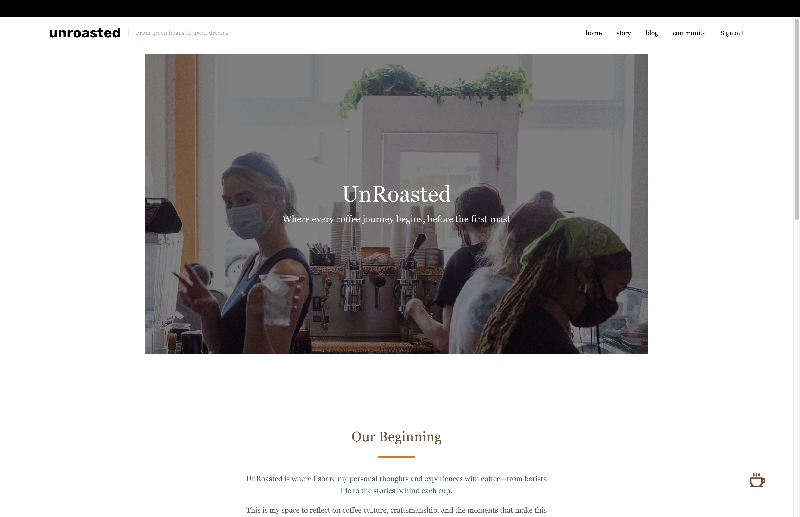
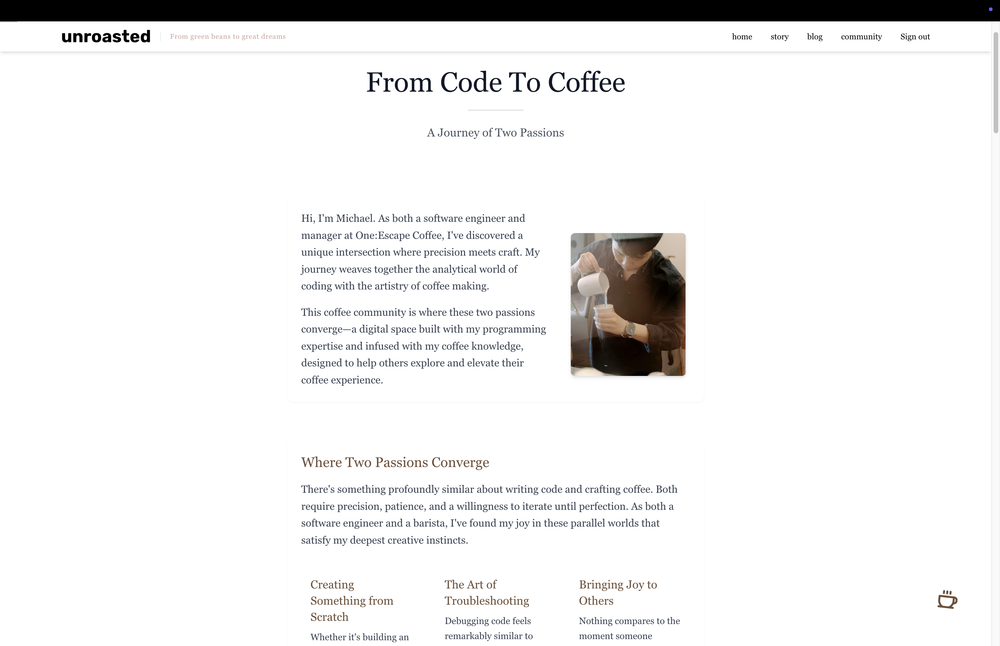
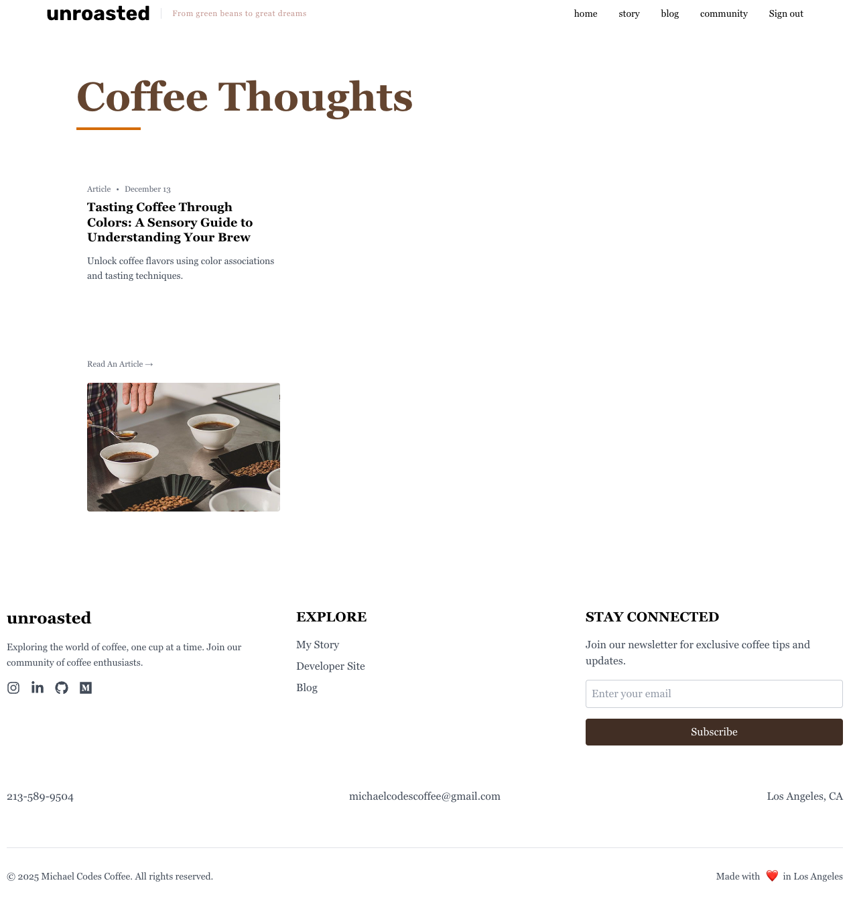
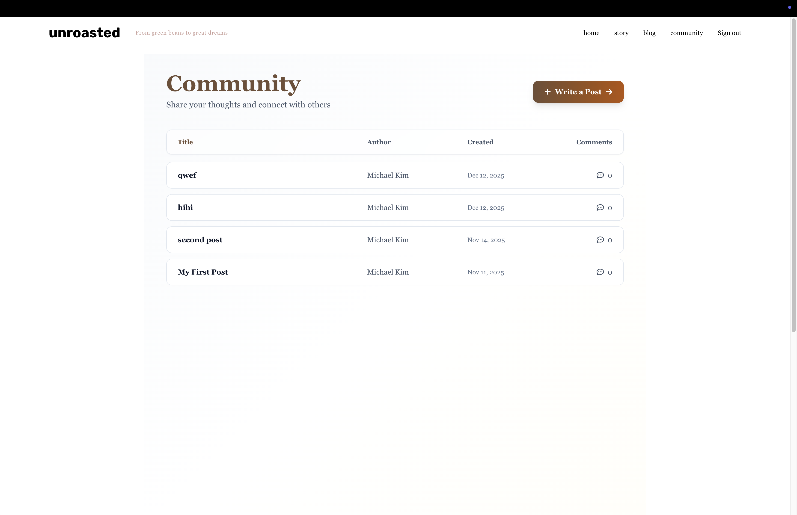
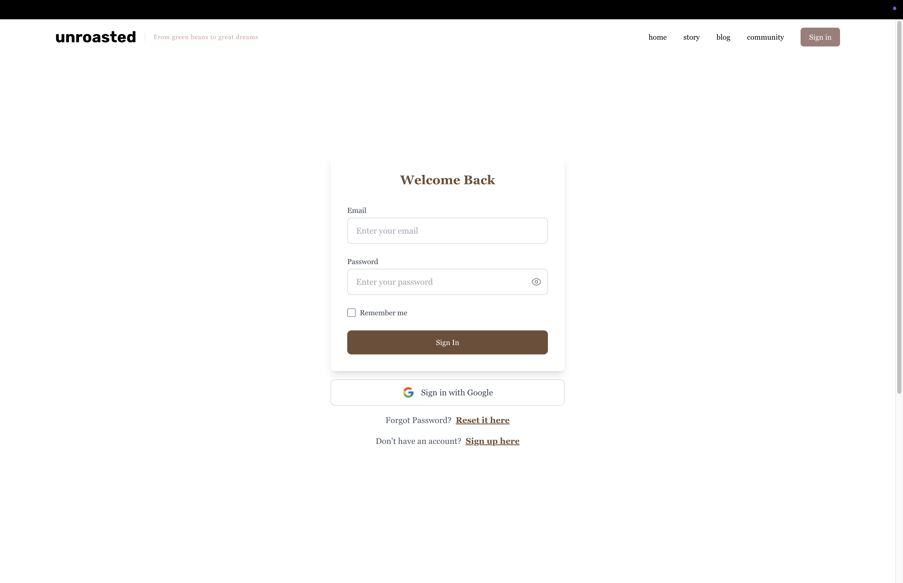

# UnRoasted

> A coffee training site, built by a coffee shop manager to stop repeating the same lessons.

## 🎯 The Problem

As a manager at RNY Coffee Studio, I train new baristas every few months, and I explain the same basics to each of them on bar: extraction, milk steaming, bean origins. Training on bar is slow, and each trainee hears a slightly different version.

## 💡 The Idea

Trainees read the basics **before** their first shift, so on-bar training can focus on hands-on skills.

UnRoasted is growing into a trainee onboarding tool:
- **Trainees** read a short training path of articles and take a quick quiz on each one
- **Managers** see who finished what, with quiz scores, before the first shift

## 🌐 Live Site
[https://unroasted.vercel.app](https://unroasted.vercel.app)

---

## 📸 Screenshots

| Home | Story |
|:----:|:-----:|
|  |  |

| Blog | Community |
|:----:|:---------:|
|  |  |

| Authentication |
|:--------------:|
|  |

---

## ✅ What Works Today

### 📚 Articles
- Coffee education articles served from a self-hosted Strapi CMS
- 2 articles published so far

### 🔐 Authentication
- Email/password and Google sign-in (Firebase Auth)
- A user profile document per account, with a role
- Protected routes for signed-in users

### 💬 Community Board
- Signed-in users can list, create, and read posts (Firestore)
- Kept secondary to the training tool; no real posts yet

### 🛡️ Security
- Firestore rules: profiles are private, users can't change their own role, and only a post's author can edit or delete it
- Secrets rotated and removed from Git history (Oct 2026)

---

## 🛠️ Tech Stack

**Frontend:** React 18, Tailwind CSS, Framer Motion, deployed on Vercel

**Content:** Strapi 5 (self-hosted on Render), Neon Postgres for article text, Cloudinary for images

**Users & community:** Firebase Auth and Firestore

---

## 🏗️ Architecture

```
                 Visitor opens unroasted.vercel.app
                                │
                                ▼
                    ┌───────────────────────┐
                    │   Website (React)     │   hosted on VERCEL
                    └───────────────────────┘
                     │                     │
        articles     │                     │   login + community posts
                     ▼                     ▼
        ┌───────────────────────┐   ┌───────────────────────┐
        │   STRAPI (the CMS)    │   │      FIREBASE         │
        │   runs on  RENDER     │   │   Auth + Firestore    │
        └───────────────────────┘   └───────────────────────┘
             │             │
     text    │             │  images
             ▼             ▼
        ┌──────────┐  ┌────────────┐
        │   NEON   │  │ CLOUDINARY │
        │ Postgres │  │   images   │
        └──────────┘  └────────────┘
```

The CMS content was migrated from Strapi Cloud to a self-hosted Strapi on Render backed by Neon Postgres.

---

## 🧭 What's Next

The goal is to make the training tool the core of the app, test it with real RNY trainees, and measure how much on-bar training time it saves.

- [ ] **Roles:** trainee and manager
- [ ] **Training path:** an ordered set of 5-8 core articles
- [ ] **Reading progress:** which articles each trainee has finished
- [ ] **Quizzes:** 3-5 questions per article
- [ ] **Manager view:** completion and quiz scores per trainee
- [ ] **Measure results** with real trainees: on-bar training hours before vs. after

Planned data model:

| Collection | Fields |
| --- | --- |
| Users | name, role (trainee or manager) |
| Articles | title, content, order in the training path |
| Progress | user, article, completed date, quiz score |

Trainees will read and write only their own progress; managers will read everyone's.

The detailed checklist lives in [TODO.md](./TODO.md).

---

## 🚀 Running Locally

```bash
git clone https://github.com/ChanYeob1202/Unroasted.git
cd Unroasted
npm install
npm start
```

Create a `.env` file in the project root first:

```
REACT_APP_API_KEY=your_firebase_api_key
REACT_APP_AUTH_DOMAIN=your_project.firebaseapp.com
REACT_APP_PROJECT_ID=your_project_id
REACT_APP_STORAGE_BUCKET=your_project.appspot.com
REACT_APP_MESSAGING_SENDER_ID=your_sender_id
REACT_APP_APP_ID=your_app_id
REACT_APP_MEASUREMENT_ID=your_measurement_id
REACT_APP_STRAPI_URL=your_strapi_url
```

Then open [http://localhost:3000](http://localhost:3000).

---

## 📁 Project Structure

```
Unroasted/
├── src/
│   ├── components/       # React components (layouts, cms, routes, home, story, ...)
│   ├── contexts/         # AuthContext
│   ├── pages/            # Page components (Home, Blog, Story, Community, Auth)
│   ├── hooks/            # Custom hooks (useAuth, useFetchApi, useFetchFirestore, ...)
│   ├── lib/              # Firebase setup
│   ├── ui/               # Reusable UI components
│   └── data/             # Static content for the Story page
├── public/               # Static assets and images
└── unRoasted/            # Strapi CMS project
```

---

## 🤝 Connect With Me

**Built with ☕ by a coffee manager who codes**

- **GitHub:** [@ChanYeob1202](https://github.com/ChanYeob1202)
- **LinkedIn:** [Michael Kim](https://www.linkedin.com/in/michael-kim-3514a9314/)
- **Portfolio:** [michaelkimdev.com](https://michaelkimdev.com/)
